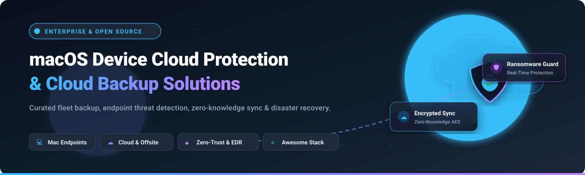

  

  
  
  
  
  
  

<h1 align="center">🛡️ Awesome macOS Device Cloud Protection & Backup 🍏</h1>

> 🔍 A comprehensive, SEO-optimized curated directory of top macOS device cloud protection, endpoint security, offsite disaster recovery, and continuous cloud backup platforms — comparing enterprise SaaS platforms with community-driven open-source alternatives.
>
> 🌟 **Star this repository** if you find it helpful for your Apple fleet engineering and endpoint security operations! 🌟

---

## 📑 Table of Contents
- [🌐 Sector Overview & Market Dynamics](#-sector-overview--market-dynamics)
- [🏢 SaaS & Hosted Commercial Platforms](#-saas--hosted-commercial-platforms)
- [💻 Open-Source macOS Backup & Protection](#-open-source-macos-backup--protection)
- [📊 Feature & Security Comparison Matrix](#-feature--security-comparison-matrix)
- [📈 Star History](#-star-history)
- [🤝 Contributing](#-contributing)
- [☕ Support & Sponsorship](#-support--sponsorship)
- [📄 License](#-license)

---

## 🌐 Sector Overview & Market Dynamics

The global endpoint backup and disaster recovery market is valued at approximately **$12.5 billion** (projected to reach over **$28 billion by 2030** at a ~13.8% CAGR), driven by remote-work expansion and escalating enterprise ransomware threats targeting Apple macOS endpoints. 

The industry exhibits **moderate fragmentation with high concentration around core segments**: enterprise fleet management is heavily clustered around dominant leaders (Commvault, Veeam, Jamf), while endpoint cloud backup for SMBs and distributed teams features specialized scale providers (Backblaze, CrashPlan, Acronis, Datto/Kaseya) competing alongside emerging modern zero-knowledge backup architectures.

---

## 🏢 SaaS & Hosted Commercial Platforms

Below is a breakdown of prominent commercial SaaS and hosted macOS cloud backup and device protection solutions, sorted in descending order by parent company valuation / annual revenue scale.

| Platform / Product | Company Size (Valuation / Revenue) | Starting Price (Specific Tier) | Free Tier / Trial Limit | Key Focus & Primary macOS Capabilities |
| :--- | :--- | :--- | :--- | :--- |
| **[Commvault Mac Client](https://www.commvault.com/)** | **~$6.5B Market Cap** (~$839M ARR) | **$12.00 /user/month** (Complete Data Protection tier) | **30-day free trial** (Full features with up to 5TB backup data & 25 workloads) | Enterprise Mac client (`Commvault.pkg`) deployed via Command Center with Active Directory, SAML SSO, and hybrid multicloud replication. |
| **[Veeam Agent for Mac](https://www.veeam.com/)** | **~$5.0B Valuation** (~$1.5B ARR) | **$10.50 /endpoint/month** ($126/yr billed annually per Agent) | **30-day free trial** (Full Enterprise Plus features, unlimited endpoints) | Standalone and centrally managed backup via Veeam Backup & Replication, backing up user profiles, APFS volumes, and Veeam Cloud Connect repos. |
| **[Acronis Cyber Protect](https://www.acronis.com/)** | **~$3.5B Valuation** (~$450M Revenue) | **$49.99 /Mac/year** (Home Office Essentials tier) | **30-day free trial** (Includes 1TB cloud storage trial) | Complete full-system disk imaging and file-level backup integrated with real-time ransomware AI guard, cloud sync, and macOS behavior monitoring. |
| **[Jamf Protect](https://www.jamf.com/)** | **~$2.1B Market Cap** (~$560M ARR) | **$6.00 /device/month** ($72/yr per device starting minimum) | **14-day free trial** (Up to 100 Mac devices with Jamf Cloud tenant access) | Native Apple macOS endpoint security (EDR, behavioral telemetry, MITRE ATT&CK compliance, next-gen antivirus; pairs with backup tools). |
| **[Druva inSync for Mac](https://www.druva.com/)** | **~$2.0B Valuation** (~$250M ARR) | **$8.00 /user/month** (inSync Enterprise tier) | **30-day free trial** (Up to 100 enterprise users, 100GB storage/user) | 100% AWS SaaS endpoint backup with global block-level deduplication, automated anomaly detection, and granular macOS profile exclusions. |
| **[Datto Endpoint Backup](https://www.datto.com/)** | **~$6.2B Kaseya Acquisition** (~$1.8B Parent Rev) | **$6.00 /Mac/month** (Direct-to-Cloud MSP partner tier) | **14-day free trial** (Full Datto Partner Portal access with 1TB test quota) | Appliance-free direct-to-cloud backup engineered for MSPs with automated differential restore, IT Glue / PSA integration, and ransomware-safe cloud. |
| **[Backblaze for Mac](https://www.backblaze.com/)** | **~$450M Market Cap** (~$115M ARR) | **$9.00 /Mac/month** ($99/year or $188 for 2 years) | **15-day free trial** (Full unlimited backup without credit card required) | Continuous, effortless unlimited personal and business computer cloud backup covering internal drives and attached external storage drives. |
| **[CrashPlan for Mac](https://www.crashplan.com/)** | **~$120M Valuation** (~$40M ARR) | **$9.99 /computer/month** (CrashPlan for Small Business tier) | **14-day free trial** (Unlimited cloud storage for up to 2 devices) | Continuous background backup runs every 15 minutes with unlimited version history retention, file recovery self-service portal, and AES-256 encryption. |

---

## 💻 Open-Source macOS Backup & Protection

The open-source ecosystem provides powerful, self-hosted, zero-knowledge encrypted solutions for Apple macOS. The list is sorted in descending order by GitHub stargazer count.

### 1. [Rclone](https://github.com/rclone/rclone) 
- **Repository:** [rclone/rclone](https://github.com/rclone/rclone)
- **Language / Tech Stack:** Go / CLI
- **License:** MIT License
- **Key Features:** Known as *"the Swiss army knife of cloud storage"*; supports synchronization, snapshotting, and encrypted mounting of 70+ cloud storage backends (AWS S3, Backblaze B2, Google Cloud Storage, WebDAV, SFTP, OneDrive) natively on macOS via Homebrew or universal binary.

### 2. [Restic](https://github.com/restic/restic) 
- **Repository:** [restic/restic](https://github.com/restic/restic)
- **Language / Tech Stack:** Go / CLI
- **License:** BSD 2-Clause License
- **Key Features:** Secure and ultra-fast client-side AES-256 encrypted backups, deduplication, point-in-time snapshots, and native support for macOS `launchd` automation with local, SFTP, or S3 cloud destinations.

### 3. [osquery](https://github.com/osquery/osquery) 
- **Repository:** [osquery/osquery](https://github.com/osquery/osquery)
- **Language / Tech Stack:** C++ / CLI & Daemon
- **License:** Apache-2.0 License
- **Key Features:** Exposes the macOS operating system as a high-performance relational database. Allows querying running Mac processes, kernel extensions, hardware events, active network connections, and security policy adherence with standard SQL.

### 4. [Duplicati](https://github.com/duplicati/duplicati) 
- **Repository:** [duplicati/duplicati](https://github.com/duplicati/duplicati)
- **Language / Tech Stack:** C# / .NET / Web UI & CLI
- **License:** LGPL-2.1 License
- **Key Features:** Free cross-platform cloud backup client providing AES-256 encrypted incremental backups, web-based control panel, scheduling, block-level deduplication, and direct upload to over 30 cloud storage vendors.

### 5. [Kopia](https://github.com/kopia/kopia) 
- **Repository:** [kopia/kopia](https://github.com/kopia/kopia)
- **Language / Tech Stack:** Go / CLI & Native GUI (KopiaUI)
- **License:** Apache-2.0 License
- **Key Features:** Fast, encrypted, deduplicated backup engine with a polished native macOS menu-bar and desktop GUI. Supports cloud storage (S3, B2, Azure, Google Cloud, SFTP), snapshot policies, and multi-user repository sharing.

### 6. [BorgBackup (Borg)](https://github.com/borgbackup/borg) 
- **Repository:** [borgbackup/borg](https://github.com/borgbackup/borg)
- **Language / Tech Stack:** Python & C (Cython) / CLI
- **License:** BSD 3-Clause License
- **Key Features:** Deduplicating archiver providing authenticated encryption (AES-256, ChaCha20-Poly1305), chunk-level delta compression, and SSH offsite server targets for macOS power users and sysadmins.

### 7. [Fleet](https://github.com/fleetdm/fleet) 
- **Repository:** [fleetdm/fleet](https://github.com/fleetdm/fleet)
- **Language / Tech Stack:** Go / Web UI & Agent
- **License:** MIT License (Core)
- **Key Features:** Open-source platform for macOS fleet visibility and device management built on osquery. Enforces disk encryption, collects real-time security posture metrics, and automates Apple MDM device compliance policies.

### 8. [Duplicacy](https://github.com/gilbertchen/duplicacy) 
- **Repository:** [gilbertchen/duplicacy](https://github.com/gilbertchen/duplicacy)
- **Language / Tech Stack:** Go / CLI & Web GUI
- **License:** Source-available (Free for non-commercial personal CLI use)
- **Key Features:** Lock-free cross-computer deduplication engine enabling multiple Mac computers to back up to the same cloud storage bucket concurrently without coordination.

---

## 📊 Feature & Security Comparison Matrix

| Solution | Model | Target Storage | Deduplication | End-to-End Encryption | Ransomware Guard | macOS Native App |
| :--- | :--- | :--- | :--- | :--- | :--- | :--- |
| **Commvault** | SaaS / Hybrid | Multicloud / Managed | Global block-level | AES-256 | Advanced AI Telemetry | macOS Client |
| **Veeam Agent** | Hybrid Managed | Cloud Connect / S3 | Source & Target | AES-256 | Immutable S3 Buckets | macOS Agent / CLI |
| **Acronis** | SaaS / Hybrid | Acronis Cloud / Local | File & Block | AES-256 | Active Protection AI | Full macOS GUI |
| **Jamf Protect** | Cloud SaaS | Telemetry (SIEM) | N/A (Security) | TLS 1.3 / mTLS | Real-time Behavioral EDR | macOS Agent / Menu bar |
| **Druva inSync** | 100% Cloud SaaS | AWS Cloud Storage | Global block-level | Envelope AES-256 | Automated behavioral alerts | macOS Background Agent |
| **Datto Endpoint** | 100% Cloud SaaS | Datto Cloud Vault | Block-level | AES-256 | Immutable cloud copies | macOS Silent Agent |
| **Backblaze** | Cloud SaaS | Backblaze Cloud | File-level | Private Key Option | Version rollback | macOS Preference Pane |
| **CrashPlan** | Cloud SaaS | CrashPlan Cloud | Block-level | Per-user AES-256 | Continuous version retention | macOS Desktop Client |
| **Rclone** | Open Source | 70+ Cloud Providers | Sync-level delta | Crypt overlay | External WORM storage | macOS CLI / FUSE mount |
| **Restic** | Open Source | S3, B2, Azure, SFTP | CDC (Chunk-level) | AES-256 / Poly1305 | S3 Object Lock supported | macOS CLI / launchd |
| **osquery / Fleet**| Open Source | Telemetry / Cloud DB | N/A (Posture) | TLS / Encrypted DB | Query-based anomaly detection| Native Mac daemon |
| **Duplicati** | Open Source | Cloud (30+ providers) | Content-aware block | AES-256 / GPG | Retention rules | Web GUI & Status Bar |
| **Kopia** | Open Source | S3, B2, GCP, Azure | Dynamic chunking | AES-256-GCM / ChaCha20 | Append-only repository | Native KopiaUI / Menu bar |
| **BorgBackup** | Open Source | Local & SSH Remote | Chunk-level CDC | AES-256 / ChaCha20 | Append-only mode | macOS CLI |

---

## 📈 Star History

---

## 🤝 Contributing

Contributions, feedback, and pull requests are warmly appreciated! 💡 

If you maintain or discover an outstanding macOS cloud backup or endpoint protection tool:
1. Fork this repository.
2. Create a dedicated branch (`git checkout -b feature/cool-macos-tool`).
3. Add your tool with verified pricing, free tier limits, star badges, and stack details.
4. Open a clear Pull Request detailing your additions.

---

## ☕ Support & Sponsorship

Thank you for visiting and supporting this curated resource! If this project helps you safeguard your Apple fleet or choose the right cloud backup stack, please consider:
- ⭐ **Starring** the repository on GitHub.
- 🍴 **Forking** and sharing with colleagues and fellow Apple sysadmins.
- ☕ **Buying a coffee & sponsoring the maintainer:** [GitHub Sponsors Dashboard](https://github.com/sponsors/ishandutta2007)

---

## 📄 License

This compilation is licensed under the [Creative Commons Zero v1.0 Universal (CC0 1.0)](LICENSE) Public Domain Dedication. Listed third-party platforms and open-source projects retain their respective trademarks, copyrights, and software licenses.
